# TalentOS

[](docs/PRD.md)
[](talentos/tests)
[](talentos/frontend)
[](talentos/app)
[](#3-ai)
[](#run-it-locally)
[](LICENSE)

**A local-first HR workspace where a recruiter can define a role, read resumes, review evidence, prepare interviews, search talent and explain a hiring decision — without a cloud bill or external AI API.**

This README is the Stage 1 proof of work. It wraps the product story, live screenshots, generated architecture/proof visuals and the three skill areas demonstrated by the build: **FRONTEND**, **BACKEND** and **AI**. The phase contract moved to [`docs/PRD.md`](docs/PRD.md).

---

## First open: what a recruiter sees

Real browser captures from the seeded `org-1` demo workspace. No illustration was substituted for the running product.

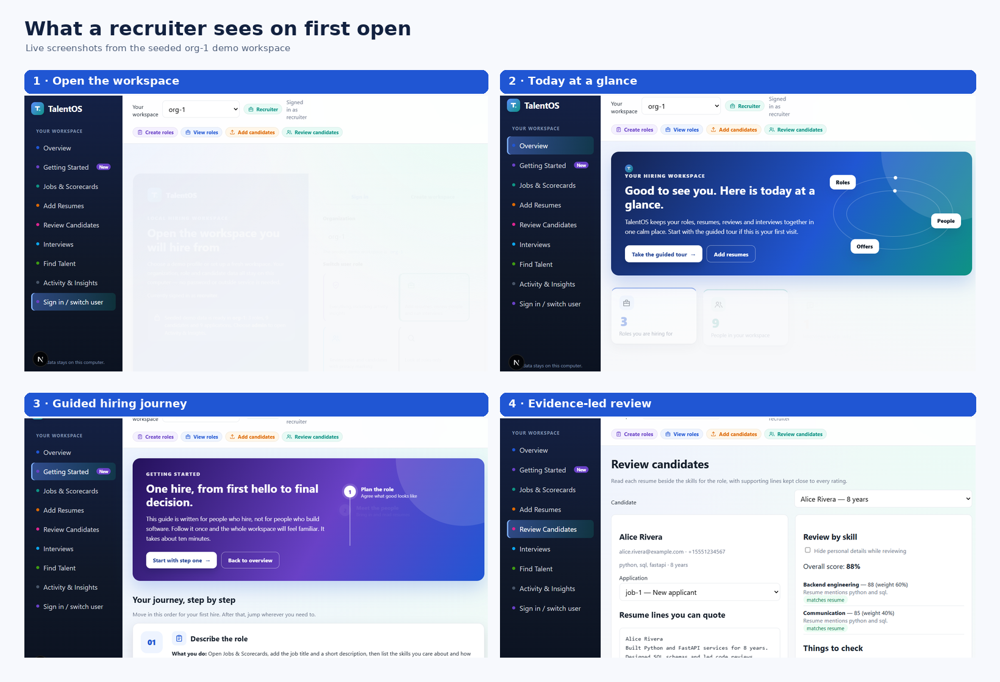

The first screen explains the workspace in HR language, offers a guided tour and shows the live hiring snapshot: roles, people, interviews, offers and candidate stages.

All captures are **viewport-sized loaded-state shots** — the browser waited until every loading label and skeleton disappeared. No full-page dumps, so the sidebar and active content stay clear.

---

## Stage 1 in one picture

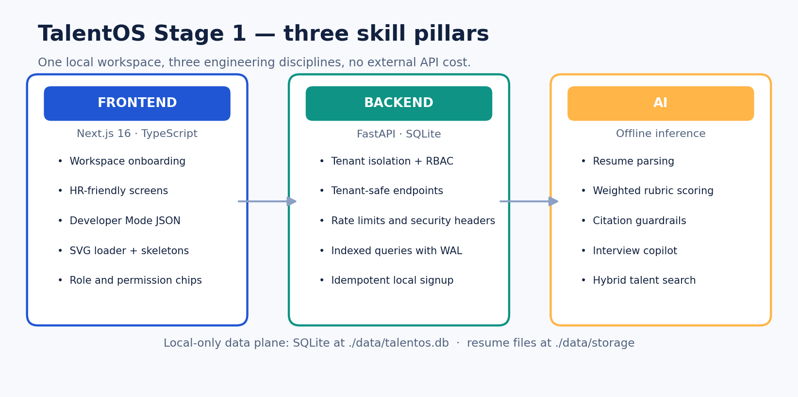

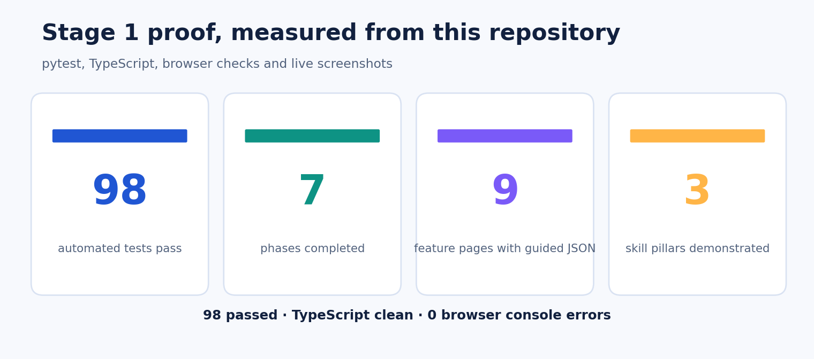

---

## Problems → goals → solutions

| Problem a hiring team feels | Goal for Stage 1 | What was built | Proof |
| --- | --- | --- | --- |
| HR screens usually look like database forms. | Make the workspace readable by a recruiter, not an engineer. | Plain-language headings, HR-interpretable permission chips, guided tour, calm color system and SVG icons. | [Guided journey](#frontend) · [Role chips](#2-backend) |
| Loading feels broken and page changes feel abrupt. | Show visible, adaptive progress without layout shift. | Animated SVG spinner, `PageSkeleton` with 420 ms minimum display, keyed `pageIn` route transition and `prefers-reduced-motion`. | [Loading and transitions](#frontend) |
| Self-registration could pollute demo data or grant admin access. | Safe professional proof of concept. | `POST /frontend/account` creates a separate workspace, forces `recruiter`, validates input, is idempotent and rate-limited. | [Safe onboarding](#2-backend) |
| Candidate data must stay inside the right organization. | Tenant isolation before any repository call. | `X-User-Id` / `X-Tenant-Id` identity, service-layer RBAC and tenant-scoped endpoints. | [Backend section](#2-backend) |
| A score without evidence is hard to defend. | Explain decisions with weighted criteria and citations. | Weighted rubric scoring, citation guardrails and an HR-readable percentage score. | [Candidate review](#3-ai) |
| Untrusted resume text and links can become an XSS path. | Secure-by-default UI and API. | Safe text nodes, URL allowlisting, CSP, CSRF headers, security headers, upload magic-byte checks and rate limits. | [Security proof](#verification) |
| A demo repository is hard to hand over. | Make every process reproducible. | Custom 404/error pages, guided JSON in every page, tests, screenshots and this README. | [Developer Mode](#developer-mode-guided-json) |

---

## 1. FRONTEND

**Evidence:** [onboarding](docs/assets/01-onboarding-login.png) · [overview](docs/assets/02-recruiter-overview.png) · [guide](docs/assets/03-guided-journey.png) · [404 page](#screenshot-gallery)

The frontend is a Next.js 16 App Router application written in strict TypeScript. It was built to feel like a product, not a dashboard skeleton.

### What I demonstrated

- **Workspace onboarding** with Sign in and Create workspace modes, profile switching for `admin`, `recruiter`, `manager` and `viewer`, and immediate workspace-bar refresh.
- **HR-first navigation** across nine feature pages: Overview, Getting Started, Jobs & Scorecards, Add Resumes, Review Candidates, Interviews, Find Talent, Activity & Insights and Sign in.
- **Owned visual system**: TalentOS `BrandMark`, custom SVG icon set, tone-based role/permission chips, stat cards, pipeline bars, insight rows and decision cards.
- **Loading and error ownership**: animated SVG spinner, skeleton pages, visible minimum delay, custom `not-found.tsx`, `error.tsx` and `global-error.tsx`.
- **Motion with restraint**: smooth page transitions plus a global `prefers-reduced-motion` fallback.
- **Performance hygiene**: cached GETs with TTL and prefix invalidation, request deduplication, debounced search, pagination and memoized heavy views.
- **Security hygiene**: no unsafe `dangerouslySetInnerHTML`, sanitized external URLs, CSRF headers on mutations and strict CSP through `src/proxy.ts`.

### Recruiter overview

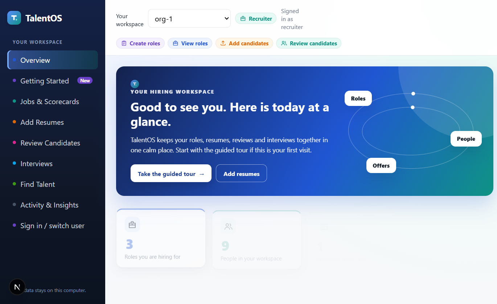

### Guided hiring journey

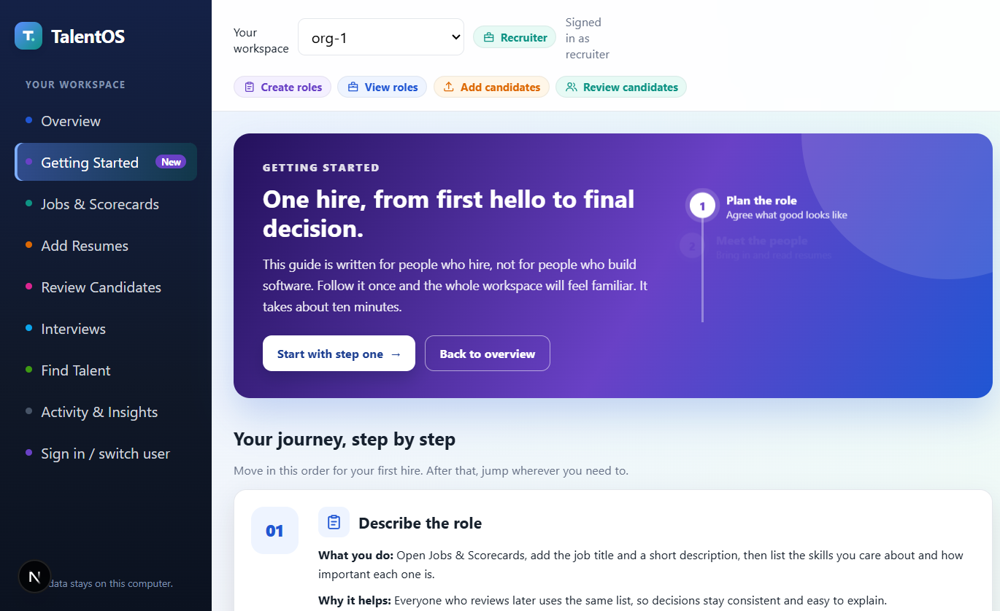

### Loading and transitions

The loader is not a browser default. It is a branded SVG with an orbiting dot and pulsing core. Route skeletons reserve the real page shape so the first paint does not jump.

```text
LoadingScreen.tsx  →  Spinner + PageSkeleton
lib/loading.ts     →  withMinimumDelay(420 ms)
AppShell.tsx       →  keyed main.page-transition
globals.css        →  pageIn + prefers-reduced-motion
```

---

## 2. BACKEND

**Evidence:** [jobs and scorecards](docs/assets/04-jobs-scorecards.png) · [admin insights](docs/assets/09-admin-insights.png) · [API contract](talentos/app/api/routes_frontend.py)

The backend is FastAPI with framework-free domain models, ports/adapters and SQLite. It enforces tenancy and RBAC in the service layer before data access, then hardens the transport layer.

### What I demonstrated

- **Multi-tenancy and RBAC** with seeded identities `admin`, `recruiter`, `manager` and `viewer`. Restricted routes are visible but locked for the active role.
- **Safe local account creation**: `POST /frontend/account` validates organization, full name and email, creates an idempotent tenant/user pair, rejects cross-workspace email conflicts and always returns `recruiter`.
- **Tenant-safe frontend endpoints** for session, jobs, candidates, insights, scoring, ingestion and account creation. Raw telemetry remains admin-only.
- **Hardened API surface**: security headers, sliding-window rate-limit buckets including `signup`, strict file size/extension/magic-byte checks and path-traversal guards.
- **SQLite performance**: composite indexes, WAL mode, synchronous NORMAL, busy timeout and N+1 query removal.
- **Explainable roles**: `GET /frontend/insights` uses `application:read`; raw telemetry stays behind admin permission.

### Jobs and weighted scorecards

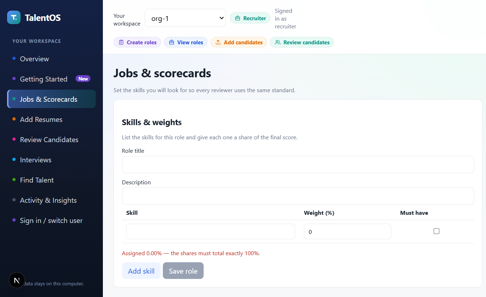

### Admin-only activity and insights

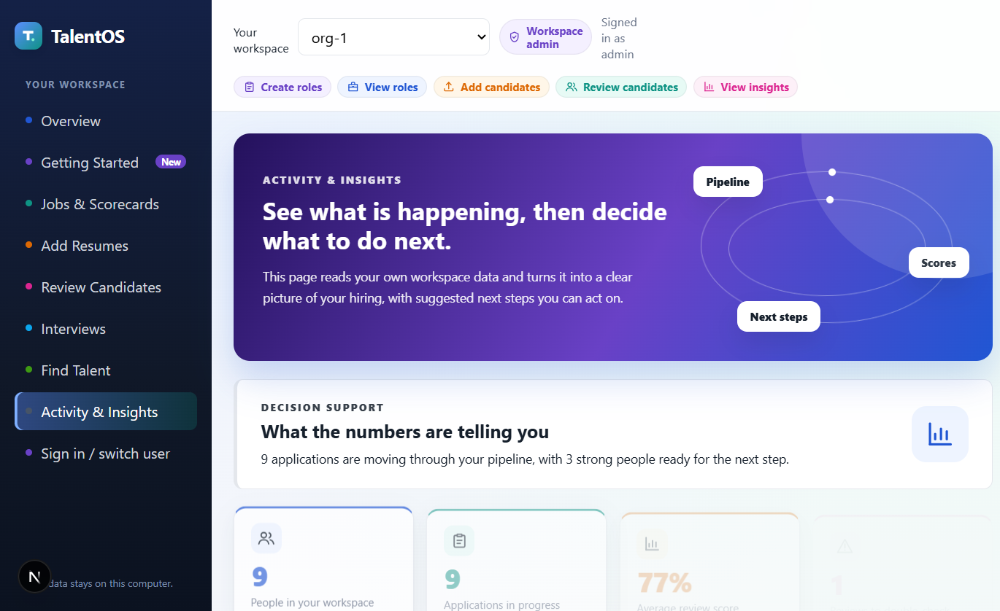

### Run and contract

```bash
cd talentos
python -m pytest -q
python -m uvicorn app.api.main:app --host 127.0.0.1 --port 8000
```

```text
98 passed
/health → {"status":"ok"}
/frontend/insights → applications=9, average_score=0.773, decisions=3, ready_to_interview=3
```

---

## 3. AI

**Evidence:** [evidence-led review](docs/assets/05-review-candidates.png) · [interview copilot](docs/assets/07-interviews.png) · [hybrid search](docs/assets/08-talent-pool.png)

The AI layer is deliberately local and deterministic for Stage 1. It proves the product mechanics without adding an external API cost or hiding decisions behind an opaque model call.

### What I demonstrated

- **Resume ingestion** that extracts text, skills, experience and education, then deduplicates by file hash.
- **Hybrid local index** combining structured skill/experience filters with lexical matching.
- **Weighted rubric scoring** with mandatory criteria, tolerance validation, confidence and rationale.
- **Citation guardrails** so a score must point back to evidence in the resume.
- **Interview copilot** that generates role- and resume-specific question guidance.
- **Talent search** by skill, experience and application stage.
- **Activity insights** that turn applications and scores into next actions for a recruiter.

### Evidence-led candidate review

Overall score is shown as a percentage, not a raw decimal.

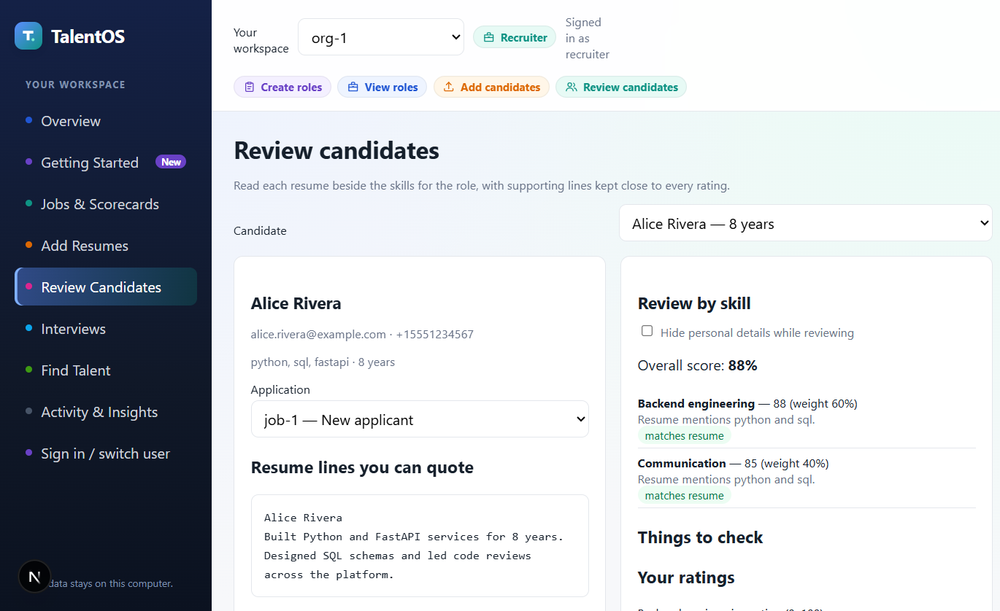

### Interview copilot and talent pool

<table>
  <tr>
    <td>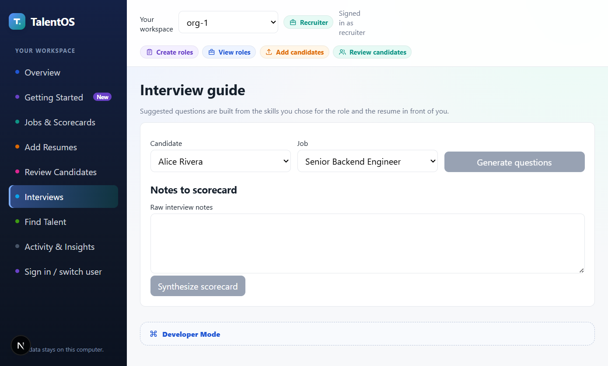</td>
    <td>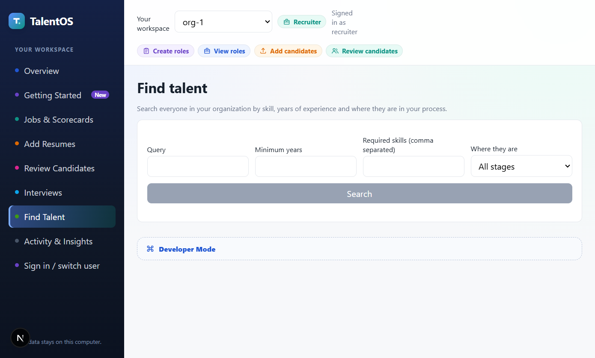</td>
  </tr>
  <tr>
    <td align="center"><b>Interview guide grounded in role + resume</b></td>
    <td align="center"><b>Search by skill, experience and stage</b></td>
  </tr>
</table>

---

## Developer Mode: guided JSON

Every feature page ends with a collapsed **Developer Mode** panel. Expanding it shows a guided process for that page and **only JSON** — method, path and body where applicable. Recruiters keep a clean page; builders get a copyable contract.

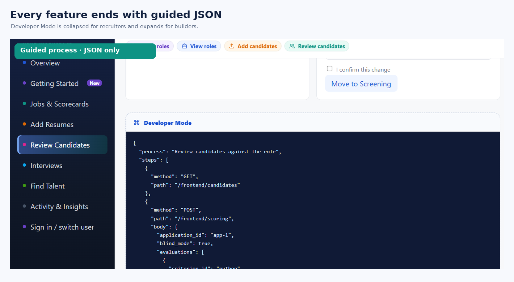

Example from Review Candidates:

```json
{
  "process": "Review candidates against the role",
  "steps": [
    {
      "method": "GET",
      "path": "/frontend/candidates"
    },
    {
      "method": "POST",
      "path": "/frontend/scoring",
      "body": {
        "application_id": "app-1",
        "blind_mode": true,
        "evaluations": [
          {
            "criterion_id": "python",
            "score": 4,
            "rationale": "Built services with Python.",
            "citations": ["Built services with Python"],
            "confidence": 0.9
          }
        ]
      }
    }
  ]
}
```

The recipes live in [`talentos/frontend/src/lib/developer-recipes.ts`](talentos/frontend/src/lib/developer-recipes.ts) and render through [`DeveloperMode.tsx`](talentos/frontend/src/components/ui/DeveloperMode.tsx).

---

## Screenshot gallery

| Screen | Live capture |
| --- | --- |
| Sign in / create workspace | 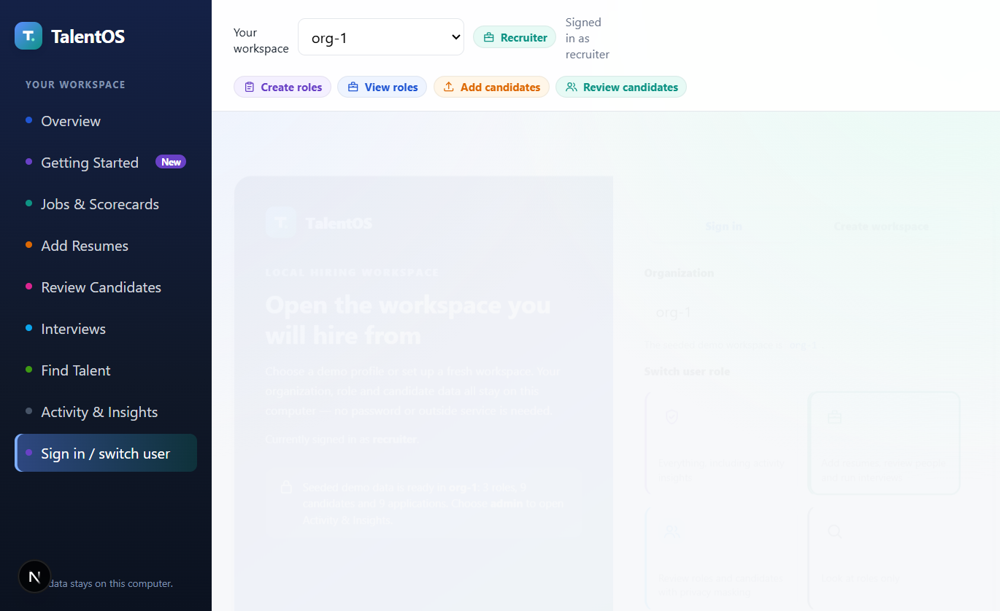 |
| Recruiter overview |  |
| Guided journey |  |
| Jobs & scorecards |  |
| Review candidates |  |
| Developer Mode JSON | 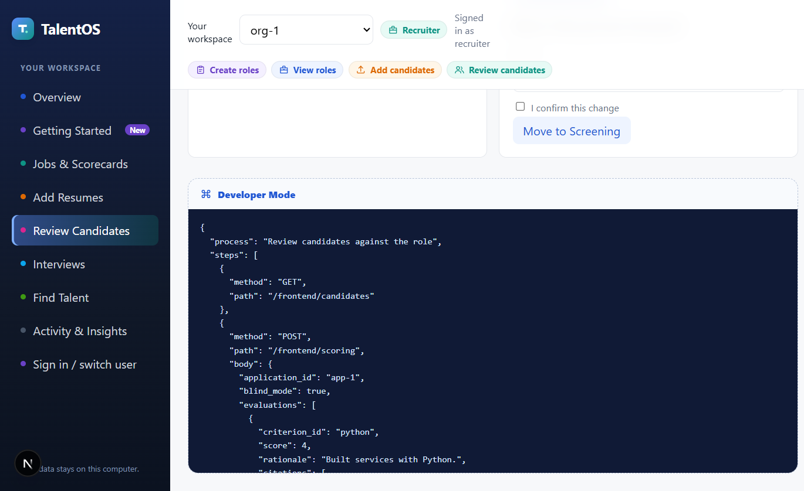 |
| Interview copilot |  |
| Find talent |  |
| Activity & Insights |  |

Generated proof visuals: [architecture](docs/assets/10-architecture-matplotlib.png) · [stage cards](docs/assets/11-stage1-proof-matplotlib.png) · [first-open collage](docs/assets/12-first-open-collage-pil.png) · [JSON strip](docs/assets/13-developer-json-pil.png).

Regenerate the matplotlib and Pillow visuals from the live screenshots:

```bash
python docs/generate_visuals.py
```

---

## Run it locally

```bash
# backend
cd talentos
python -m pytest -q
python -m uvicorn app.api.main:app --host 127.0.0.1 --port 8000

# frontend, in a second terminal
cd talentos/frontend
npm run dev
```

Open <http://localhost:3000>.

- Choose **recruiter** in `org-1` for the seeded demo: 3 roles, 9 candidates and 9 applications.
- Choose **admin** in `org-1` to unlock Activity & Insights.
- Choose **Create workspace** to make a new empty workspace. New accounts are always recruiters and never receive admin or telemetry access.

The repository pins the frontend toolchain in `package.json` / `package-lock.json`. Stage 1 added no new dependency. All application state stays under `talentos/data/`; the browser keeps only the selected local identity.

---

## Repository map

```text
.
├── docs/
│   ├── PRD.md                  # phase contract + Stage 1 acceptance criteria
│   ├── generate_visuals.py     # matplotlib + Pillow proof generator
│   └── assets/                 # live screenshots + generated visuals
├── skills/                     # phase execution contracts
└── talentos/
    ├── app/                    # domain, ports, adapters, services, API
    ├── frontend/               # Next.js 16 App Router UI
    └── tests/                  # 98 automated checks
```

---

## Verification

```text
rtk tsc --noEmit                 → No errors found
rtk run python -m pytest -q      → 98 passed
live browser console             → 0 errors
POST /frontend/account           → 201 Created, role=recruiter
unknown route                    → branded TalentOS 404
Review Candidates score          → percentage, not decimal
```

---

## Stage 2 ideas

- Admin invitation flow and managed role assignment.
- Saved interview scorecards with decision history.
- Optional external model adapter behind the same local inference port.
- Exportable audit pack for hiring decisions.

---

## License

[MIT](LICENSE) — free to use, study, modify and share. Built as a local-first open-source proof of work by Osama Gharib Elwaly.
