# TalentOS

Local-first, zero-cost HR platform built in five phases. All adapters run in-process;
no external services, containers, or paid APIs are required or started automatically.

## System architecture

```mermaid
flowchart LR
    C[Client: X-User-Id + X-Tenant-Id] --> A[FastAPI app/api]
    A --> S[Services]
    S --> P[Ports / Protocols]
    P --> D[Adapters]
    D --> L[(SQLite + local files + JSON index)]

    subgraph S
      Auth[AuthService / RBAC]
      Jobs[JobService / rubric]
      Ingest[IngestionService]
      Score[ScoringService]
      Copilot[InterviewCopilot]
      Search[TalentSearchService]
      Pipeline[PipelineService + audit_logs]
      Telemetry[TelemetryService]
    end

    subgraph P
      Repo[RepositoryPort]
      Store[StoragePort]
      Queue[QueuePort]
      Infer[InferencePort]
      Vector[VectorIndexPort]
    end

    subgraph D
      SQLite[SQLiteRepository]
      LocalStore[LocalStorage]
      LocalQueue[LocalAsyncQueue]
      Offline[OfflineExtractor]
      Hybrid[LocalHybridIndex: TF-IDF]
    end
```



Domain models and rules live in `app/domain/` and depend on nothing framework-specific.
Services depend only on `app/ports/`; adapters implement those protocols. Swapping an
adapter never requires changing a service.

## Local startup

Run from `talentos/`:

```bash
python -m pytest                 # full suite
python -m evals.run_evals        # golden-set benchmark (0 pass / 1 regression)
python -m uvicorn app.api.main:app --reload
```

All state is local: SQLite at `./data/talentos.db`, resumes at `./data/storage/`,
index at `./data/hybrid_index.json`. Requests must carry `X-User-Id` and `X-Tenant-Id`;
the authenticated user's tenant is the authority for every read.

## Adapter swap flags

Settings come from environment variables (see `.env.example`). Defaults are local-only.

| Flag | Default | Swaps |
| --- | --- | --- |
| `TALENTOS_INFERENCE_BACKEND` | `offline` | Only `offline` is bundled; any other value fails closed without a network call. Replace `OfflineExtractor` to add a backend. |
| `TALENTOS_DB_PATH` | `./data/talentos.db` | Repository storage; implement `RepositoryPort` for Postgres. |
| `TALENTOS_STORAGE_DIR` | `./data/storage` | Resume bytes; implement `StoragePort` for MinIO/S3. |
| `TALENTOS_INDEX_PATH` | `./data/hybrid_index.json` | TF-IDF index; implement `VectorIndexPort` for pgvector. |
| `TALENTOS_MAX_BATCH_SIZE` | `50` | Per-batch queue cap. |
| `TALENTOS_RUBRIC_TOLERANCE` | `1e-6` | Rubric weight-sum tolerance. |

No Postgres, Redis, or MinIO adapter is enabled by default — the compose entries are
templates only (see below).

## RBAC matrix

| Permission | ADMIN | RECRUITER | HIRING_MANAGER | VIEWER |
| --- | :-: | :-: | :-: | :-: |
| `job:create` | ✓ | ✓ | — | — |
| `job:read` | ✓ | ✓ | ✓ | ✓ |
| `application:create` | ✓ | ✓ | — | — |
| `application:read` | ✓ | ✓ | ✓ | — |
| `telemetry:read` | ✓ | — | — | — |

Hiring managers see masked email/phone until an application reaches `SHORTLISTED`.
Stage transitions are enforced by `PipelineService`: `OFFER` and `REJECTED` require an
explicit `confirm` flag plus a reason, are written to `audit_logs`, and can only be
recommended (never applied) through `recommend()`.

## Evaluation benchmark

`python -m evals.run_evals` output from this environment:

```text
TalentOS golden-set evaluation
cases: 4
schema_validity: 100.00% (4/4)
citation_pass_rate: 96.88% (31/32)
rank_order: PASS strong=0.8850 partial=0.5850 mismatch=0.1700
avg_latency_ms: 9.628
tokens_in: 584; tokens_out: 66
telemetry_events: 4
docker_lint: PASS
RESULT: PASS
```

Schema validity, citation pass rate, rank ordering, and the exit code are deterministic;
`avg_latency_ms` is wall-clock and varies by machine. The harness also lints the Docker
blueprint (Dockerfile multi-stage structure and compose profile gating) without building
or starting anything. Exit code is `0` on pass and `1` on any regression.

Fixtures are synthetic/anonymized resumes in `evals/fixtures/golden_resumes.json`;
the single deliberately fabricated citation keeps the pass-rate target at ≥95%.

## Telemetry

Metrics (`operation`, `provider`, `model`, `latency_ms`, `tokens_in`, `tokens_out`,
`citation_pass_rate`, `status`) are persisted per tenant. Admins can read an aggregate:

```bash
curl -H 'X-User-Id: <admin-id>' -H 'X-Tenant-Id: <tenant>' \
  http://localhost:8000/api/v1/telemetry/summary
```

## Docker blueprint (not executed)

`Dockerfile` is a two-stage slim Python image; `docker-compose.yml` starts only `app`
with local adapters. Postgres/pgvector, Redis, and MinIO are declared under the `infra`
profile and cannot start unless explicitly requested:

```bash
docker compose config                 # validate only
docker compose up                     # local mode (when you choose to run it)
docker compose --profile infra up     # opt-in infrastructure
```

These commands were **not** run while building this phase; the blueprint is validated
by the eval harness's static lint only. No image was pulled and no container started.
